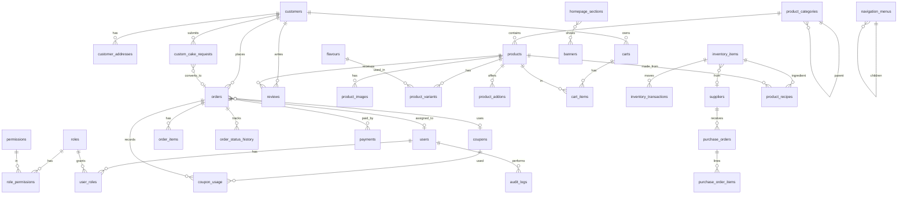

# Cake Studio – Architecture & Delivery Plan

Repository state at start: **empty**. Project is created from scratch.

## 1. System Architecture

```
                    ┌──────────────────────────────┐
                    │   Browser (Storefront/Admin) │
                    └──────────────┬───────────────┘
                                   │ HTTPS
                          ┌────────▼────────┐
                          │  Nginx (proxy)  │  serves built React SPA, proxies /api
                          └───┬─────────┬───┘
                 static SPA   │         │ /api/v1
                              │   ┌─────▼──────────────────────────┐
                              │   │ FastAPI (uvicorn/gunicorn)     │
                              │   │  api → services → repositories │
                              │   │  auth/RBAC, rate limit, audit  │
                              │   └──┬────────┬────────┬───────────┘
                              │      │        │        │
                        ┌─────▼──┐ ┌─▼─────┐ ┌▼──────┐ ┌▼───────────────┐
                        │Postgres│ │ Redis │ │ S3 /  │ │ SMTP, WhatsApp │
                        │        │ │(rate  │ │Cloud- │ │ Cloud API,     │
                        │        │ │limit, │ │inary  │ │ payment gateway│
                        │        │ │queue) │ │       │ │ (adapters)     │
                        └────────┘ └───────┘ └───────┘ └────────────────┘
```

### Backend layering (clean architecture)
- `api/` – routers, request/response schemas (Pydantic), dependency injection, permission guards.
- `services/` – business rules (pricing engine, checkout, slot capacity, coupon validation, stock deduction, notifications).
- `repositories/` (introduced as modules grow) – DB access via SQLAlchemy 2.0.
- `models/` – SQLAlchemy models with `TimestampMixin` and `SoftDeleteMixin`.
- `core/` – config (env-driven), security (argon2/bcrypt, JWT), logging, errors, rate limiting.
- `integrations/` – adapter interfaces: `StorageProvider` (Cloudinary/S3), `EmailProvider`, `WhatsAppProvider`, `PaymentGateway`. Chosen and configured from DB settings + env secrets.

### Frontend structure
- `apps` share one Vite project with two route trees: `/` (storefront) and `/admin` (dashboard), lazily code-split.
- TanStack Query for server state, React Hook Form + Zod for forms, shadcn/ui primitives, Tailwind theme tokens driven by CSS variables loaded from `/api/v1/public/settings` (so theme is admin-configurable, nothing hardcoded).

### Key cross-cutting decisions
| Concern | Decision |
|---|---|
| Auth | JWT access (15 min) + refresh (7 d, rotated, stored hashed, revocable). Staff and customers are separate principals. |
| RBAC | `permissions` are code strings (`orders.read`, `products.write`…). Roles map to permissions via `role_permissions`. Super Admin bypasses; Admin edits other roles' permissions. |
| Money | `NUMERIC(12,2)`; all pricing computed server-side. Client totals are display only. |
| Pricing | base/sale price + variant delta + flavour/filling/size deltas + add-ons, via a single `PricingService` used by cart, checkout and quotes. |
| Settings/CMS | Key/value JSONB `website_settings` by group; `homepage_sections` with `sort_order` + `is_visible`; public read endpoint cached. |
| Soft delete | `deleted_at` on products, categories, customers, coupons, pages, etc. |
| Audit | Every admin mutation writes `audit_logs` (actor, action, entity, before/after). |
| Uploads | MIME sniffing, size cap, extension allowlist, re-encoded, random keys. |
| Payments | Gateway adapter + signed webhook verification; manual payments recorded with verifier. |
| Notifications | `notifications` outbox table processed by a worker; email/WhatsApp toggled via settings. |
| Security | CORS allowlist, security headers, rate limiting (login, tracking, checkout), CSRF not needed for bearer-token API (refresh cookie uses SameSite=Strict + double-submit if cookie mode). |

## 2. Database ERD (Mermaid)



Additional tables beyond the brief's list (required to satisfy its features): `role_permissions`, `refresh_tokens`, `delivery_slots`, `blocked_dates`, `payment_methods`, `purchase_order_items`, `product_recipes` (BOM), `newsletter_subscribers`, `contact_messages`, `product_option_groups` (size/weight/filling choices with price deltas), `social_gallery_items`, `team_members`.

## 3. Module Breakdown

| # | Module | Backend router | Admin UI | Storefront UI |
|---|---|---|---|---|
| 1 | Auth & RBAC | `/auth`, `/admin/roles`, `/admin/users` | Users, Roles & permissions | Login/Register |
| 2 | Settings & Theme | `/admin/settings`, `/public/settings` | General, Theme, SEO, Social | Theme tokens, header/footer |
| 3 | CMS | `/admin/pages`, `/admin/homepage`, `/admin/navigation`, `/admin/banners`, `/admin/testimonials` | Section builder, menus | Home, About, Contact, static pages |
| 4 | Catalog | `/admin/categories`, `/admin/products`, `/admin/flavours` | CRUD, variants, images, reorder | Shop, product detail |
| 5 | Cart & Checkout | `/cart`, `/checkout`, `/delivery/slots` | Slots, blocked dates, payment methods | Cart, checkout |
| 6 | Orders & Payments | `/admin/orders`, `/orders/track`, `/payments` | Order lifecycle, invoices, refunds | Tracking, account orders |
| 7 | Custom cakes | `/custom-cakes`, `/admin/custom-cakes` | Quotation workflow | Request form |
| 8 | Inventory | `/admin/inventory`, `/admin/suppliers`, `/admin/purchase-orders` | Stock, BOM | – |
| 9 | Customers | `/admin/customers`, `/me` | Profiles, notes | Account, addresses |
| 10 | Promotions | `/admin/coupons` | Coupons, banners | Coupon apply |
| 11 | Reports & Dashboard | `/admin/dashboard`, `/admin/reports` | Charts, Excel/PDF export | – |
| 12 | Notifications | `/admin/notifications` | Bell, templates | Email/WhatsApp |

## 4. API Specification (v1, base `/api/v1`)

**Auth**: `POST /auth/login`, `/auth/refresh`, `/auth/logout`, `/auth/register` (customer), `/auth/customer/login`, `/auth/password/forgot|reset`, `GET /auth/me`.

**Public**: `GET /public/settings`, `/public/homepage`, `/public/navigation`, `/public/pages/{slug}`, `/public/categories`, `/public/products` (q, category, min_price, max_price, sort=popular|price_asc|price_desc|latest, page), `/public/products/{slug}`, `POST /public/products/{id}/price` (option-based quote), `/public/testimonials`, `POST /public/newsletter`, `POST /public/contact`, `GET /public/delivery/slots?date=`, `GET /public/payment-methods`.

**Cart/Checkout**: `GET/POST /cart`, `POST /cart/items`, `PATCH|DELETE /cart/items/{id}`, `POST /cart/coupon`, `DELETE /cart/coupon`, `POST /checkout/quote`, `POST /checkout` (guest or customer), `POST /payments/{order}/gateway-session`, `POST /payments/webhook/{provider}`.

**Orders**: `GET /orders/track?order_number&phone`, `GET /me/orders`, `GET /me/orders/{no}`; admin: `GET /admin/orders`, `GET|PATCH /admin/orders/{id}`, `POST /admin/orders/{id}/status`, `/assign`, `/notes`, `/payments`, `/refunds`, `GET /admin/orders/{id}/invoice.pdf`.

**Custom cakes**: `POST /custom-cakes` (multipart), admin: `GET /admin/custom-cakes`, `POST /admin/custom-cakes/{id}/quote`, `POST /admin/custom-cakes/{id}/convert`.

**Admin CRUD (all with list/create/get/update/delete + `/reorder` where ordered)**: `categories`, `products` (+ `/variants`, `/images`, `/addons`), `flavours`, `coupons`, `banners`, `testimonials`, `pages`, `navigation`, `homepage/sections`, `settings/{group}`, `delivery-slots`, `blocked-dates`, `payment-methods`, `users`, `roles` (+ `/permissions`), `customers` (+ `/notes`), `inventory/items|transactions|adjust`, `suppliers`, `purchase-orders` (+ `/receive`), `audit-logs`.

**Analytics**: `GET /admin/dashboard?from&to`, `GET /admin/reports/{type}?from&to&format=json|xlsx|pdf`.

Conventions: JSON, ISO-8601 UTC, pagination `?page&page_size` returning `{items,total,page,page_size}`, errors `{error:{code,message,details}}`, idempotency key on `POST /checkout`.

## 5. Development Roadmap

| Phase | Scope | Exit criteria |
|---|---|---|
| 1 | Repo, Docker Compose, config, all SQLAlchemy models, Alembic migration, JWT auth, RBAC, seed | Login works; permission guards tested; migration applies |
| 2 | Admin shell, settings, theme, CMS, navigation, homepage builder | Storefront theme changes from admin |
| 3 | Categories, products, variants, images, pricing engine | Option prices correct in tests |
| 4 | Storefront pages, dynamic homepage, SEO | All content from API |
| 5 | Cart, coupons, checkout, delivery slots | Guest + customer order placed |
| 6 | Orders, payments, invoices, notifications | Full lifecycle + tracking |
| 7 | Inventory/BOM, promotions, customers, reports | Excel/PDF exports |
| 8 | Test coverage, security review, performance, deploy docs | CI green, hardened images |


## Implementation notes (deviations from the original plan)

- Delivery slots endpoint takes `?day=` (not `?date=`).
- Customer accounts exist alongside guest checkout; accounts are never auto-linked to guest records by phone.
- Redis was dropped from Docker Compose: rate limiting is in-process (per worker). Switch `services/ratelimit.py` to Redis before running several backend replicas.
- No online payment gateway yet (deferred by request). Payment methods are COD, bank transfer, pay on pickup, with manual verification by staff; the `online` method is a placeholder until a gateway and signed webhooks are added.
- Images are stored on a local volume (`/media`) by default. Set `STORAGE_BACKEND=s3` plus the `S3_*` variables for any S3-compatible service (`services/s3.py`, AWS Signature V4 implemented with the standard library, no SDK). The bucket must be publicly readable (or fronted by a CDN) at `S3_PUBLIC_BASE_URL`, and the uploading key should be allowed only `s3:PutObject` on the `uploads/` prefix. Cloudinary is not implemented. If you serve images from a CDN host, add it to `img-src` in `frontend/nginx.conf`.
